<!-- Visuals live in assets/ and are generated by tools/build.py (dark + light variants). -->

<picture>
  <source media="(prefers-color-scheme: dark)" srcset="./assets/header-dark.svg">
  
</picture>

<p align="center">
  <a href="https://studio33s.com"><b>studio33s.com</b></a> &nbsp;·&nbsp;
  <a href="https://www.linkedin.com/in/gagandeep-khokhar-971727314"><b>LinkedIn</b></a> &nbsp;·&nbsp;
  <a href="mailto:gagan.khokhar.dev@gmail.com"><b>gagan.khokhar.dev@gmail.com</b></a>
</p>

<br>

### `~/about`

I build LLM systems end to end, starting at the Linux and virtualization layer and going up through inference serving, Python automation and the web apps people actually use. At work I run open-source models in production with **Ollama on Proxmox**, and I ship full-stack apps on **Next.js, React and Fastify** with CI/CD that deploys itself. Most days I work agent-first in **Claude Code**, with the rules written down in `CLAUDE.md`.

```console
$ cat now.txt
→ building    agentic tools and self-hosted AI infrastructure
→ shipping    a real-time server dashboard and a studio platform with its own CMS
→ learning    the Claude Developer Platform: agents, tool use, MCP
→ looking     for AI / LLM developer roles · remote or relocation
```

<br>

### `~/projects`

<table>
  <tr>
    <td width="50%" valign="top">
      <a href="https://studio33s.com"><picture>
        <source media="(prefers-color-scheme: dark)" srcset="./assets/card-studio33s-dark.svg">
        
      </picture></a>
    </td>
    <td width="50%" valign="top">
      <picture>
        <source media="(prefers-color-scheme: dark)" srcset="./assets/card-vps-monitor-dark.svg">
        
      </picture>
    </td>
  </tr>
  <tr>
    <td width="50%" valign="top">
      <picture>
        <source media="(prefers-color-scheme: dark)" srcset="./assets/card-lex-eq-dark.svg">
        
      </picture>
    </td>
    <td width="50%" valign="top">
      <picture>
        <source media="(prefers-color-scheme: dark)" srcset="./assets/card-llm-dark.svg">
        
      </picture>
    </td>
  </tr>
  <tr>
    <td width="50%" valign="top">
      <picture>
        <source media="(prefers-color-scheme: dark)" srcset="./assets/card-agency-3d-dark.svg">
        
      </picture>
    </td>
    <td width="50%" valign="top">
      <picture>
        <source media="(prefers-color-scheme: dark)" srcset="./assets/card-bots-dark.svg">
        
      </picture>
    </td>
  </tr>
</table>

<sub>Most of these repos are private. Happy to give a walkthrough.</sub>

<br><br>

### `~/stack`

<picture>
  <source media="(prefers-color-scheme: dark)" srcset="./assets/stack-dark.svg">
  
</picture>

<br>

<picture>
  <source media="(prefers-color-scheme: dark)" srcset="./assets/footer-dark.svg">
  
</picture>
